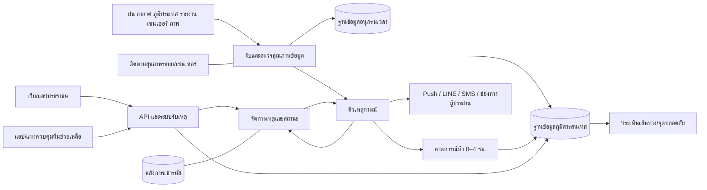

# Flood Monitoring System for Thailand

เอกสารออกแบบระบบฉบับตั้งต้นสำหรับประชาชนและทีมช่วยเหลือ เป้าหมายคือช่วยให้คนตัดสินใจได้เร็วขึ้นเมื่อเกิดน้ำท่วม โดยไม่อ้างว่าการคาดการณ์หรือเส้นทางปลอดภัยได้ 100%

## 1. หลักการออกแบบ

- **เปิดใช้ได้ทันที:** ประชาชนเปิดเว็บหรือแอปแล้วดูแผนที่ แจ้งเหตุ และขอความช่วยเหลือได้โดยไม่สร้างบัญชี ใช้รหัสเคสแบบสุ่มแทนบัญชีสำหรับติดตามเรื่อง
- **ข้อมูลหลายแหล่ง:** ระบบไม่ผูกกับข้อมูลจากหน่วยงานรัฐแหล่งเดียว ใช้รายงานชุมชน สถานีวัดฝน/ระดับน้ำของโครงการ ผู้ให้บริการพยากรณ์อากาศ ภาพถ่ายดาวเทียมหรือภาพจากผู้ใช้ และข้อมูลถนน/ภูมิประเทศจากผู้ให้บริการหรือชุมชน ข้อมูลรัฐเป็นแหล่งเสริมได้
- **บอกเวลาและความเชื่อมั่น:** แสดงแหล่งข้อมูล เวลาที่พบ และสถานะยืนยันของรายงานทุกจุด ค่าระดับน้ำเป็นข้อมูลประกอบและประวัติ ไม่แสดงเป็นค่าจริงที่แม่นยำแน่นอน
- **ตัดสินใจแบบระมัดระวัง:** เมื่อข้อมูลขัดแย้ง ล้าสมัย หรือไม่มีข้อมูล ให้ทำเครื่องหมาย “ไม่ทราบ/ควรหลีกเลี่ยง” และไม่จัดเส้นทางนั้นเป็นเส้นทางปลอดภัย
- **ออกแบบสำหรับภัยพิบัติ:** หน้าหลักโหลดเร็ว ปุ่มสำคัญใหญ่ ใช้สีร่วมกับข้อความ/สัญลักษณ์ รองรับโปรแกรมอ่านหน้าจอ ภาษาไทยที่อ่านง่าย และมีโหมดตัวอักษรใหญ่
- **ความเป็นส่วนตัว:** ไม่ติดตามประชาชนต่อเนื่องโดยปริยาย แชร์ตำแหน่งสดเฉพาะเมื่อร้องขอความช่วยเหลือและมีความยินยอม พร้อมหยุดหรือหมดอายุการแชร์ได้

## 2. ผู้ใช้และประสบการณ์หลัก

### ประชาชน

หน้าหลักมีปุ่มขนาดใหญ่ 5 รายการ: **ดูพื้นที่เสี่ยง**, **หาเส้นทาง**, **จุดปลอดภัย**, **ขอความช่วยเหลือ**, และ **รายงานเหตุ** ผู้ใช้ค้นหาด้วยตำแหน่งปัจจุบันหรือปักหมุดเองได้ หากไม่อนุญาต GPS

รายงานเหตุได้โดยไม่สมัครสมาชิก เลือกประเภท เช่น น้ำท่วม ถนนผ่านไม่ได้ ไฟรั่ว/สายไฟตก สัตว์อันตราย หรือเหตุอื่น แนบภาพ ตำแหน่ง และข้อความสั้นได้ ระบบแสดงเลขเคสและลิงก์ส่วนตัวสำหรับติดตามสถานะ

การขอถุงยังชีพให้ปักหมุดจุดรับ ระบุจำนวนชุด จำนวนผู้รับ ประเภทที่จำเป็น และช่องทางติดต่อทางเลือก เช่น เบอร์โทร ระบบเตือนว่าคำขอได้รับแล้ว แต่ไม่รับประกันว่าจะมีของหรือส่งถึงก่อนเวลาใด

### ทีมช่วยเหลือและผู้ประสานงาน

ใช้แผงควบคุมเว็บ/แท็บเล็ตและแอปภาคสนามที่ต้องเข้าสู่ระบบตามบทบาท ได้แก่ ผู้คัดกรอง ผู้จ่ายงาน ทีมกู้ภัย ทีมถุงยังชีพ ผู้ดูแลข้อมูล/เซนเซอร์ และผู้ประสานหน่วยงาน เห็นเฉพาะข้อมูลที่จำเป็นต่อหน้าที่

แผนที่ปฏิบัติการแสดงเคสตามระดับเร่งด่วน อายุรายงาน ความเชื่อมั่น จำนวนผู้ประสบภัย ความเสี่ยงปลายทาง ทีมที่รับผิดชอบ และเส้นทางเข้าถึง แสดงรายงานที่ยังไม่ยืนยันแยกจากข้อมูลที่ตรวจสอบแล้ว

## 3. ความสามารถของระบบ

| ความสามารถ | แนวทางการทำงาน |
|---|---|
| เตือนก่อนน้ำท่วม | คาดการณ์พื้นที่เสี่ยงล่วงหน้า 0–4 ชั่วโมง ส่งเตือนเมื่อพื้นที่ที่เลือกหรือเส้นทางบันทึกไว้มีความเสี่ยงเพิ่มขึ้น แจ้งทั้งเวลาโดยประมาณและระดับความเชื่อมั่น |
| คาดการณ์แนวทางน้ำ | แสดงพื้นที่ที่คาดว่าน้ำจะขยายไป ทิศทาง/ช่วงเวลาที่คาด และความไม่แน่นอนเป็นชั้นข้อมูลบนแผนที่ ไม่แสดงเป็นเส้นทางการไหลที่แน่นอน |
| นำทางหลบพื้นที่น้ำ | คำนวณเส้นทางโดยพิจารณารายงานน้ำท่วม ถนนปิด แนวโน้ม 3–4 ชั่วโมง และเวลาปรับปรุงข้อมูล ให้หลีกเลี่ยงจุดเสี่ยงที่ความเชื่อมั่นต่ำ |
| แยกตามพาหนะ | ผู้ใช้เลือกรถเก๋ง มอเตอร์ไซค์ รถกระบะยกสูง รถเมล์ หรือเรือ ระบบประเมินความผ่านได้ของแต่ละช่วงถนน/ทางน้ำ และแสดง “ผ่านได้ตามข้อมูลล่าสุด”, “เสี่ยง”, “ห้ามผ่าน”, หรือ “ไม่มีข้อมูล” |
| จุดปลอดภัย | ค้นหาศูนย์พักพิง จุดรวมพล โรงพยาบาล จุดจอดรถ และจุดรับส่งที่ได้รับการรายงาน พร้อมสถานะเปิด/เต็ม/ไม่ทราบ เวลาอัปเดต ความจุและสิ่งอำนวยความสะดวกถ้ามี |
| ประวัติระดับน้ำ | กราฟย้อนหลังต่อสถานี พร้อมแหล่ง เวลา หน่วย และธงคุณภาพข้อมูล แสดงช่องว่างเมื่อเซนเซอร์ขาดช่วง ไม่ลากเส้นให้ดูเหมือนมีค่าจริง |
| แจ้งเหตุพร้อมภาพ | ส่งภาพ ตำแหน่ง เวลา ประเภทเหตุ และข้อความสั้น รายงานจากประชาชนเป็น “ยังไม่ยืนยัน” จนกว่าจะมีหลักฐานหรือผู้ตรวจสอบยืนยัน |
| ขอความช่วยเหลือ | ส่งตำแหน่ง จำนวนคน ผู้บาดเจ็บ/ผู้เปราะบาง ประเภทความช่วยเหลือ และระดับเร่งด่วน กรณีพบสัตว์อันตรายจัดเป็นเคสเฉพาะและส่งต่อทีมที่ได้รับมอบหมาย |
| ขอถุงยังชีพ | ปักจุดส่ง ระบุจำนวนชุด จำนวนคน และความต้องการ ระบบรวมคำขอใกล้กันให้ทีมจัดรอบส่งได้โดยไม่ลบคำขอต้นทาง |
| ติดตามเคสแดง | เมื่อผู้ใช้กดยืนยันเคสเร่งด่วนและยินยอมแชร์ตำแหน่ง ระบบส่งตำแหน่งล่าสุดให้ทีมที่รับเคสจนกว่าจะปิดเคสหรือหมดอายุ ผู้ใช้เห็นสถานะการแชร์และหยุดได้ |
| ไฟรั่ว/สายไฟตก | แจ้งเตือนผู้ใช้อื่นในบริเวณที่อาจได้รับผลกระทบ และส่งเคสให้ผู้ประสานงานหรือช่องทางหน่วยงาน/ผู้ให้บริการไฟฟ้าที่ตั้งค่าไว้ แสดงชัดเจนว่าส่งสำเร็จ รอส่ง หรือยังไม่มีผู้รับยืนยัน |
| แจ้งเตือนหลายช่องทาง | แจ้งในเว็บ/แอป, push, LINE และ SMS ตามตัวเลือกและการยินยอมของผู้ใช้ การใส่เบอร์หรือเชื่อม LINE เป็นการสมัครรับการแจ้งเตือนเฉพาะช่องทาง ไม่ใช่การสมัครบัญชีระบบ |
| สุขภาพเซนเซอร์ | ตรวจ heartbeat ค่าค้าง แบตเตอรี่/การเชื่อมต่อ และค่าผิดปกติ เปิดเคสแจ้งทีมบำรุงรักษาและซ่อน/ลดน้ำหนักข้อมูลเซนเซอร์ที่ผิดปกติ |
| คำแนะนำ | แสดงคำแนะนำตามสถานการณ์และตำแหน่ง เช่น ก่อนอพยพ ระหว่างเดินทาง น้ำเข้าบ้าน ไฟฟ้า และสัตว์อันตราย เนื้อหาต้องผ่านผู้เชี่ยวชาญและแสดงเมื่ออัปเดตล่าสุด |

## 4. การคาดการณ์และการแสดงความไม่แน่นอน

บริการคาดการณ์ทำงานต่อเนื่องและสร้างผลลัพธ์เป็นกริดพื้นที่หรือช่วงถนน ทุก 10–15 นาที โดยมีระยะคาดการณ์ถึง 4 ชั่วโมง แยกผลเป็น **โอกาสเกิดน้ำท่วม**, **ช่วงเวลาที่อาจเริ่มกระทบ**, **แนวโน้มระดับ/ทิศทางน้ำ**, และ **ความเชื่อมั่นของข้อมูล**

อินพุตประกอบด้วยฝนที่เกิดขึ้นและพยากรณ์ระยะสั้น ภูมิประเทศ/ความสูง พื้นผิวเมืองและทางระบายน้ำ รายงานภาคสนาม เซนเซอร์ของระบบ และภาพถ่ายที่มีเวลาถ่ายที่ตรวจได้ ระบบใช้แบบจำลองน้ำฝน-น้ำท่า/การไหลร่วมกับการเรียนรู้จากรายงานย้อนหลัง และประเมินหลายสมมติฐานเมื่อข้อมูลไม่ครบ

แสดงผลด้วยข้อความที่เข้าใจง่าย เช่น **เฝ้าระวัง**, **มีโอกาสท่วม**, **มีรายงานน้ำท่วม**, และ **ยืนยันแล้ว** พร้อมเวลาข้อมูล หลีกเลี่ยงตัวเลขความน่าจะเป็นที่ดูแม่นเกินคุณภาพข้อมูล ทดสอบย้อนหลังและปรับเทียบกับเหตุการณ์จริงในแต่ละภูมิภาคก่อนใช้แจ้งเตือนวงกว้าง

การเตือนผิดพลาดและการพลาดเตือนเป็นสิ่งที่เกิดได้ ทุกการเตือนต้องมีคำอธิบายสั้น ๆ ว่าคาดจากอะไรและควรทำอะไร ผู้ใช้สามารถรายงานผลจริงเพื่อปรับปรุงแบบจำลองได้โดยไม่ทำให้รายงานหนึ่งรายการเปลี่ยนสถานะพื้นที่ทั้งบริเวณทันที

## 5. การนำทางและความปลอดภัยของเส้นทาง

เส้นทางแบ่งเป็นช่วงถนน/ทางน้ำ และแต่ละช่วงมีสถานะ **ผ่านได้ตามข้อมูลล่าสุด**, **ควรระวัง**, **หลีกเลี่ยง**, หรือ **ข้อมูลไม่พอ** พร้อมเวลาและหลักฐาน ระบบประเมินทั้งสภาพปัจจุบันและคาดการณ์ก่อนผู้ใช้ไปถึงช่วงนั้น

การประเมินพาหนะใช้ประเภทรถร่วมกับระดับ/ความเชื่อมั่นของน้ำ สภาพผิวทาง กระแสน้ำ สิ่งกีดขวาง และข้อจำกัดของเส้นทาง เรือใช้เครือข่ายทางน้ำและข้อมูลสิ่งกีดขวางเฉพาะ ไม่อนุมานว่าถนนที่รถผ่านไม่ได้จะกลายเป็นทางเรือที่ปลอดภัย รถยกสูงหรือรถเมล์ไม่ถือว่าปลอดภัยเพียงเพราะสูงกว่ารถเก๋ง

ผลค้นหาต้องบอกความเสี่ยงที่ปลายทางและช่วงทางเข้าให้ถึง หากปลายทางไม่มีข้อมูลสถานะ ให้แสดงว่า **ยังยืนยันการเข้าถึงไม่ได้** และเสนอจุดปลอดภัยทางเลือก เส้นทางอัปเดตใหม่เมื่อมีรายงานถนนปิด น้ำเพิ่ม หรือข้อมูลสำคัญเปลี่ยน พร้อมเตือนว่าควรหยุดในที่ปลอดภัยหากพบสภาพจริงต่างจากแผนที่

## 6. สถานะเหตุและขั้นตอนปฏิบัติงาน

สถานะเคสความช่วยเหลือ: **รับเรื่องแล้ว → คัดกรอง → จ่ายงาน → กำลังเดินทาง → ถึงจุดเกิดเหตุ → ช่วยเหลือแล้ว → ปิดเคส** มีสถานะ **รอข้อมูล/ติดต่อไม่ได้/ยกเลิก** แยกต่างหาก การเปลี่ยนสถานะบันทึกผู้เปลี่ยนและเวลา และส่งการอัปเดตให้ผู้ร้องขอ

เจ้าหน้าที่คัดกรองจัดลำดับจากอันตรายต่อชีวิต จำนวนคน ผู้บาดเจ็บ เด็ก/ผู้สูงอายุ/ผู้พิการ การเข้าถึง และอายุข้อมูล ระบบช่วยจัดลำดับแต่ให้ผู้จ่ายงานยืนยันการมอบหมาย ทุกทีมรายงานพิกัดและสถานะงานเป็นช่วง ๆ ระหว่างปฏิบัติการ

รายงานสัตว์อันตรายต้องไม่แนะนำให้ผู้ใช้เข้าใกล้ ผู้ใช้ส่งภาพจากระยะปลอดภัยได้ ระบบแจ้งให้ถอยห่างและกั้นพื้นที่หากทำได้โดยไม่เสี่ยง จากนั้นส่งต่อผู้เชี่ยวชาญ/ทีมที่รับผิดชอบชนิดสัตว์นั้น

## 7. โหมดเครือข่ายและความพร้อมใช้งาน

ไม่กำหนด offline mode เต็มรูปแบบตามความต้องการ แต่เมื่อการเชื่อมต่อขาด หน้าจอต้องแสดงเวลาที่ได้รับข้อมูลล่าสุดและป้าย **ข้อมูลอาจล้าสมัย** อย่างเด่นชัด ไม่ยืนยันว่าเส้นทางยังปลอดภัย และไม่ให้คำขอ/รายงานดูเหมือนส่งสำเร็จจนกว่าจะได้รับการตอบรับจากเซิร์ฟเวอร์

บริการหลักเปิด 24/7 ออกแบบให้ทำงานหลาย availability zones มีสำรองฐานข้อมูลและไฟล์ภาพ คิวส่งงาน/แจ้งเตือนเมื่อผู้ให้บริการขัดข้อง และมีสถานะบริการสาธารณะ เป้าหมายเริ่มต้นที่เสนอคือ uptime 99.95% ต่อเดือนสำหรับการดูแผนที่/แจ้งเหตุ, กู้บริการหลักภายใน 30 นาที และข้อมูลสูญหายไม่เกิน 5 นาที เป้าหมายนี้ต้องยืนยันกับทีมปฏิบัติการก่อนประกาศเป็น SLA

## 8. ภาพรวมสถาปัตยกรรม

ส่วนประกอบหลัก ได้แก่ API gateway, บริการรายงานและเคส, ตัวเชื่อมแหล่งข้อมูล, ตัวตรวจคุณภาพข้อมูล, ฐานข้อมูลเชิงภูมิสารสนเทศและอนุกรมเวลา, คลังภาพ, คิวเหตุการณ์, บริการคาดการณ์, เครื่องมือประเมินเส้นทาง, ระบบแจ้งเตือน และแผงควบคุมทีม ระบบจัดเก็บ audit log และติดตามสุขภาพทุกบริการ

## 9. ข้อมูลหลัก

- **Observation:** ตำแหน่ง/พื้นที่, ค่าหรือประเภทเหตุ, เวลาเกิด, เวลารับเข้า, แหล่งที่มา, สถานะตรวจสอบ, ความเชื่อมั่น
- **Forecast:** พื้นที่/ช่วงถนน, ช่วงเวลาคาดการณ์, ความเสี่ยง, ทิศทางการขยาย, รุ่นแบบจำลอง, อินพุต และคุณภาพข้อมูล
- **RoadSegment / Place:** รูปทรงแผนที่, ประเภทการเดินทาง, ข้อจำกัด, สถานะน้ำ/การเข้าถึง, ความจุหรือสถานะเปิด, หลักฐานและเวลาล่าสุด
- **Incident / AidRequest:** หมายเลขเคส, ประเภท, พิกัด, ความเร่งด่วน, จำนวนคน/สิ่งของ, สถานะ, ทีมรับผิดชอบ, ประวัติการเปลี่ยนสถานะ
- **Sensor / HealthEvent:** ตำแหน่ง, ชนิด, ค่าที่อ่าน, heartbeat, สถานะแบตเตอรี่/เครือข่าย, เหตุผิดปกติ และการซ่อม
- **NotificationSubscription:** ช่องทางและพื้นที่ที่ผู้ใช้เลือก ความยินยอมและเวลาหมดอายุ โดยไม่ต้องสร้างบัญชี

## 10. ความปลอดภัยและการคุ้มครองข้อมูล

- ประชาชนส่งเคสแบบไม่ระบุตัวตนได้ ใช้ CAPTCHA/rate limit และตรวจสแปมเพื่อป้องกันการก่อกวน โดยไม่บังคับสร้างบัญชี
- พิกัดสดเข้าถึงได้เฉพาะเจ้าหน้าที่ที่ได้รับเคสและมีบทบาทตรงกับงาน เข้ารหัสระหว่างส่งและขณะจัดเก็บ พร้อมบันทึกการเปิดดู
- ขอความยินยอมก่อนแชร์ตำแหน่งสด จำกัดช่วงเวลาเก็บข้อมูล และหยุด/หมดอายุการแชร์อัตโนมัติเมื่อเคสจบ
- ภาพและข้อมูลส่วนบุคคลมีอายุเก็บตามนโยบายที่ประกาศ แยกข้อมูลติดต่อออกจากข้อมูลแผนที่ และไม่เปิดเผยตำแหน่งบ้านของผู้ร้องต่อสาธารณะ
- การส่งรายงานให้หน่วยงาน/ผู้ให้บริการภายนอกต้องแสดงผู้รับและผลตอบรับจริง หากเชื่อมต่อไม่ได้ให้แจ้งประชาชนและทีมปฏิบัติการอย่างชัดเจน

## 11. แผนส่งมอบ

1. **ระยะนำร่อง:** แผนที่รายงานน้ำท่วมพร้อมเวลา/สถานะยืนยัน, จุดปลอดภัย, แจ้งเหตุแบบไม่สมัคร, ขอความช่วยเหลือและถุงยังชีพ, แผงคัดกรองและอัปเดตสถานะ
2. **ระยะนำทาง:** สถานะถนนและตัวกรองพาหนะ, การประเมินความเสี่ยงปลายทาง, LINE/SMS/push, ประวัติระดับน้ำและสุขภาพเซนเซอร์
3. **ระยะคาดการณ์:** พยากรณ์พื้นที่และแนวทางน้ำ 0–4 ชั่วโมง, เตือนตามพื้นที่, การคาดการณ์ช่วงถนน และการประเมินความแม่นยำผ่านเหตุการณ์นำร่อง
4. **ระยะปฏิบัติการเต็มรูปแบบ:** ติดตาม GPS เคสแดง, ประสานไฟฟ้า/ทีมสัตว์อันตราย, การจัดสรรทรัพยากร, ระบบสำรองหลายพื้นที่ และซ้อมเหตุฉุกเฉิน

ก่อนเปิดใช้ระดับประเทศควรเริ่มนำร่องในพื้นที่เสี่ยงต่างลักษณะกัน เก็บผลจริงทั้งกรณีเตือนถูก/ผิดและพลาดเตือน ตรวจสอบภาษาบนแผนที่กับประชาชนหลายวัย และซ้อมเหตุที่ระบบแจ้งเตือนหรือผู้ให้บริการแผนที่/ข้อความหยุดทำงาน

## 12. เกณฑ์ความสำเร็จ

- ผู้ใช้เปิดแผนที่และแจ้งเหตุได้โดยไม่สร้างบัญชี
- ทุกข้อมูลเสี่ยงแสดงเวลา แหล่งที่มา และสถานะความน่าเชื่อถือ
- เส้นทางที่ไม่มีหลักฐานเพียงพอไม่แสดงเป็นเส้นทางปลอดภัย และรองรับการกรองพาหนะครบตามที่กำหนด
- เคสช่วยเหลือและคำขอถุงยังชีพติดตามสถานะได้ตั้งแต่รับเรื่องจนปิด
- เคสแดงแชร์ GPS เฉพาะช่วงที่ได้รับความยินยอมและอยู่ระหว่างช่วยเหลือ
- ทีมเห็นและแก้ไขสถานะเซนเซอร์เสีย รวมถึงเหตุไฟฟ้า/สัตว์อันตรายที่ต้องส่งต่อ
- ระบบคาดการณ์วัดผลแยกตามพื้นที่และช่วงเวลาล่วงหน้า พร้อมรายงานทั้ง false alarm และ missed event
- ผู้ใช้ทดสอบหลายวัยสามารถเข้าใจความเสี่ยง ปลายทาง และเวลาของข้อมูลได้โดยไม่ต้องอาศัยสีเพียงอย่างเดียว
